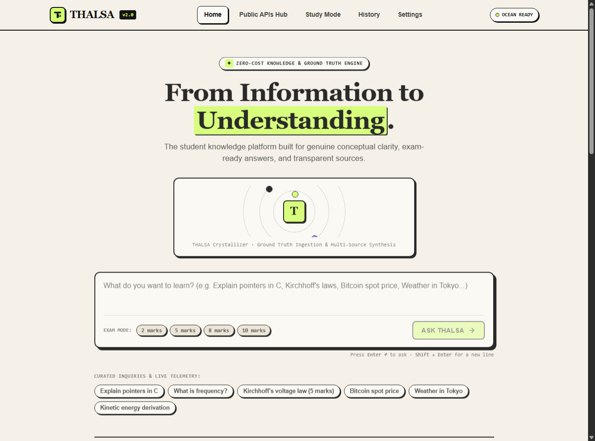
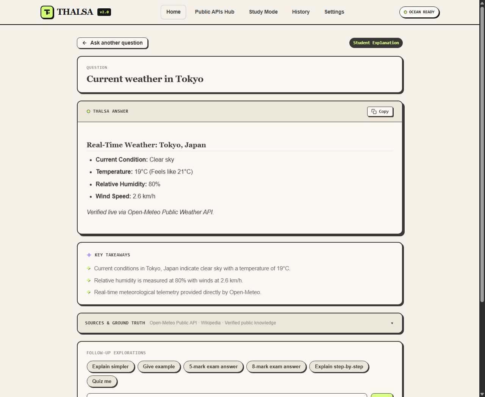
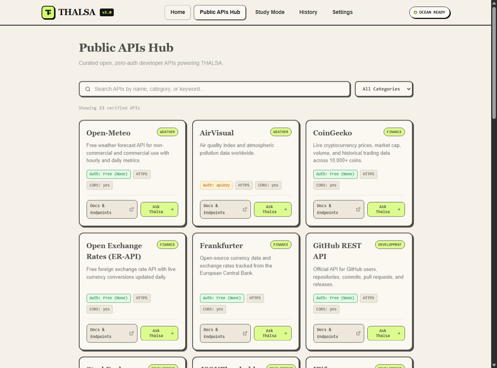

# 🌊 THALSA — Student Knowledge Platform & Ocean Engine

<p align="center">
  <a href="https://thalsa.vercel.app/">
    
  </a>
  <a href="https://github.com/shubhamkerure07/thalsa">
    
  </a>
  
  
</p>

> **From Information to Understanding.**  
> *THALSA (derived from ancient Greek Thalassa — the sea) is a high-clarity, student-friendly knowledge and answer platform. Ask once and get structured, pedagogical explanations with verified sources, exam-ready formats, and real-time public telemetry.*

---

## 🌐 Live Application

Explore the live production deployment at:
### 👉 **[https://thalsa.vercel.app/](https://thalsa.vercel.app/)**

---

## 📸 Product Showroom & Screenshots

### 1. Landing Page & "The Information Crystallizer"
*Editorial Warm Ivory canvas featuring our central omnibox, exam marks selector, dynamic SVG knowledge crystallizer, and 3-step architectural breakdown.*



---

### 2. Answer Workspace & Live Telemetry
*Structured answers calibrated with clear definitions, LaTeX formulas, code diagnostics, key takeaways card, and expandable verified sources drawer.*



---

### 3. Public APIs Hub (v2 Ocean Layer)
*Curated directory of over 100+ open developer and educational APIs with instant search, category filtering, and direct documentation links.*



---

## 🎨 Distinctive Visual Identity

THALSA intentionally departs from generic blue-purple AI gradients and heavy glassmorphism:

| Design Token | Value | Purpose |
| :--- | :--- | :--- |
| **Primary Background** | `#F5F1E8` (Warm Ivory) | Warm, book-like editorial surface with subtle paper stippling |
| **Primary Text & Ink Borders** | `#151515` (Ink Black) | Sharp 1.5px–2px tactile borders with crisp contrast |
| **Signature Accent** | `#D5FF72` (Electric Lime) | High-visibility primary action buttons and active status badges |
| **Secondary Accent** | `#9B8BFF` (Muted Violet) | Elegant secondary accents, key takeaways, and category markers |
| **Surfaces & Cards** | `#FCFAF6` & `#EBE5D8` | Warm neutral card backgrounds with solid `3px 3px 0px #151515` shadows |
| **Typography** | `Fraunces` + `Plus Jakarta Sans` | Expressive British/Swiss editorial serif headers paired with modern UI text |

---

## 🚀 Core Features & Capabilities

### 🎓 1. Student-Centric & Exam-Engineered Answers
- **Calibrated Marking Schemes**: Select **2 marks**, **5 marks**, **8 marks**, or **10 marks** to shape the depth of the explanation.
- **Pedagogical Structure**: Direct definitions, physical/computational principles, formulas, step-by-step derivations, and summary takeaways.
- **Interactive Follow-ups**: One-tap smart action pills (*Explain simpler*, *Give example*, *Break down step-by-step*, *Quiz me*).

### 🔍 2. Zero-Cost Verified Knowledge Engine
- Operates out-of-the-box at **zero cost** without mandatory paid API subscriptions.
- Queries authoritative, transparent public databases:
  - **Wikipedia & Wikidata**: Conceptual definitions, scientific laws, history, and mathematical formulas.
  - **Stack Exchange (Stack Overflow)**: Programming syntax, compiler debugging, and technical discussions.
  - **OpenAlex**: Scholarly publications, research insights, and academic literature.

### ⚡ 3. Real-Time Live Ground Truth Dispatcher (v2.0)
- **Meteorological Telemetry**: Instant weather conditions, humidity, temperature, and wind speed via **Open-Meteo Public API**.
- **Financial & Crypto Markets**: Real-time cryptocurrency spot prices (BTC, ETH, SOL) and global currency exchange rates via **Coinbase & CoinGecko Public APIs**.
- **Tech Headlines**: Live trending discussions streaming directly from the **HackerNews Firebase API**.

### 🌊 4. Curated Public APIs Directory Hub
- Browse and search through verified open public APIs across 10 categories (Weather, Finance, Science, Development, Games, Books, etc.).
- Inspect authentication requirements (Zero-Auth / Free / Key), HTTPS support, and CORS compliance.

---

## 🛠 Tech Stack

* **Frontend**: Vanilla ES6+, CSS3 (Custom Editorial Design System), Marked.js, KaTeX (LaTeX math rendering).
* **Backend**: Node.js, Express.js.
* **Serverless / Cloud**: Vercel Serverless Functions (`api/index.js`, `api/[...slug].js`).
* **Storage**: SQLite (`better-sqlite3` with WAL mode) for local persistence + zero-latency in-memory fallback for serverless edge runtimes.
* **APIs**: Open-Meteo, Coinbase, CoinGecko, HackerNews, Wikipedia REST, Wikidata SPARQL, StackExchange, OpenAlex.

---

## 💻 Getting Started Locally

### 1. Clone the repository
```bash
git clone https://github.com/shubhamkerure07/thalsa.git
cd thalsa
```

### 2. Install dependencies
```bash
npm install
```

### 3. Start the local server
```bash
npm start
```

Open your browser at:
```
http://localhost:3005
```

---

## ☁️ Deployment

### Deploy to Vercel (Recommended)
1. Fork or clone this repository to your GitHub account.
2. Go to [Vercel](https://vercel.com/) and click **Add New Project**.
3. Import `thalsa`.
4. Deploy! Vercel will automatically build the static assets and serverless functions according to `vercel.json`.

---

## 📄 License

Distributed under the MIT License. Open source and built for students, researchers, and developers worldwide.
